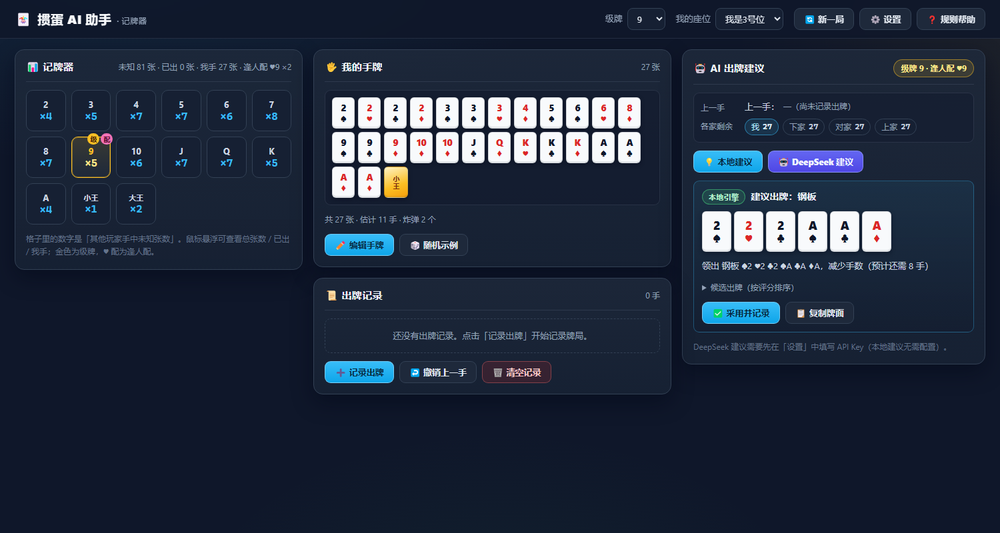

# 掼蛋 AI 助手 · 记牌器

参照 `hullqin斗地主` 助手（记牌器 + 出牌提示 + 托管）的思路，为**掼蛋**（4 人 2 队、两副牌 108 张）制作的辅助工具：

- 📋 **记牌器**：108 张牌按点数实时统计「剩余 / 已出 / 我手」，级牌与逢人配（红桃级牌）单独标记；
- 🃏 **我的手牌**：108 张选牌器逐张录入，或一键「随机示例」发牌演示；
- 📝 **出牌记录**：四个座位轮流记录「出牌 / 过」，自动维护记牌器、各家剩余张数与 AI 的上一手，可撤销、清空；
- 💡 **本地 AI 建议**：内置启发式引擎，纯本地计算、无需联网；
- 🤖 **DeepSeek AI 建议**：接入 [DeepSeek API](https://platform.deepseek.com/)，让大模型在本地候选出牌里挑最优解，并给出理由；未配置 Key 或请求失败时自动回退本地建议。

> 为什么是独立网页而不是油猴脚本：`game.hullqin.cn` 并没有掼蛋（其斗地主有 4 人双副牌变体，但不是完整掼蛋规则）。因此本项目不做页面注入，而是一个**双击即用、可离线运行的单页应用**。



## 快速开始

1. 双击打开 `hullqin掼蛋/index.html`（Chrome / Edge / Firefox 等现代浏览器均可，`file://` 直接可用）；
2. 顶栏选择本局**级牌**和**我的座位**；
3. 点「编辑手牌」录入自己手上的 27 张（或点「随机示例」看演示）；
4. 牌局进行时用「记录出牌」依次记录各家出牌 / 过牌（记牌器与 AI 会自动跟随）；
5. 轮到我出牌时点「本地建议」或「DeepSeek 建议」，查看理由后点「采用并记录」写回牌局。

整个工具无后端、无外链 CDN、无框架，所有数据只保存在你浏览器本机的 `localStorage`。

## DeepSeek API 配置（可选）

点顶栏「设置」：

| 配置项 | 默认值 | 说明 |
|---|---|---|
| API Key | 空 | 在 [platform.deepseek.com](https://platform.deepseek.com/api_keys) 创建，`sk-…` 开头 |
| Base URL | `https://api.deepseek.com` | OpenAI 兼容接口地址，一般不用改 |
| 模型 | `deepseek-chat` | 也可填 `deepseek-reasoner` |
| 温度 | `0.2` | 出牌任务建议低温，保持稳定 |
| 超时 | `30000` ms | 超时自动回退本地建议 |

- Key 只保存在**本机** `localStorage['gdAI.settings']`，不会上传到任何第三方，也不会写进代码仓库；
- 「测试连接」会用当前配置发起一次最小请求，验证 Key 与网络；
- 使用 DeepSeek API 会产生费用，请以官方计费为准；
- DeepSeek 接口已允许浏览器跨域直连（本项目实测 `OPTIONS` 与 `file://` 下 `fetch` 均可通过）。

**工作原理**：本地引擎先枚举全部合法出牌候选（最多 12 个），再把局面（级牌、手牌、上一手、各座剩余张数、剩余大牌统计、本地建议）打包成结构化 prompt 发给 DeepSeek，要求它以 JSON 从候选中选择；返回结果与本地候选逐一校验，不合规则回退本地建议，绝不让 AI 编造出不存在的牌。

## 规则口径（与本工具引擎一致）

- 4 人 2 队、两副牌共 108 张，每人 27 张；本工具只做单局辅助，**不实现整局升级、进贡 / 还贡**；
- 牌型：单张、对子、三同张、三带二（不可三带一）、顺子（恰好 5 连）、三连对（3 个连续对子）、钢板（2 个连续三同张）、同花顺、炸弹（4 张及以上同点）；
- 级牌：当前级牌的点数大小仅次于王，大于 A；**红桃级牌为逢人配**，可当任意非王牌使用（单独出时仍按级牌点数算）；
- 大小顺序：大王 > 小王 > 级牌 > A > K > Q > J > 10 > 9 > 8 > 7 > 6 > 5 > 4 > 3 > 2（级 A 时 A 最大）；
- 炸弹体系：4 炸 < 5 炸 < 同花顺 < 6 炸 < 7 炸 < … < 10 炸 < 四大天王（2 大王 + 2 小王，最大）；
- 顺子 / 连对 / 钢板中 A 可作 1 或 14（如 A2345、10JQKA、QQKKAA）；三连对最大到 QQKKAA，钢板最大到 KKKAAA；
- 比较：普通牌型同型比「顶位」点数，三带二只比三张；炸弹按张数 / 等级比，可压任意普通牌型。

## 文件结构

| 文件 | 作用 |
|---|---|
| `index.html` / `app.js` / `style.css` | 单页界面（无框架、file:// 可用），负责记牌器、选牌器、记录、AI 面板与设置 |
| `gd.core.js` | 规则引擎（全局 `GDEngine`）：牌型解析、比牌、候选出牌生成、记牌统计、发牌 |
| `gd.ai.js` | 本地启发式 AI（全局 `GDAI`）：候选评分、局面建议、手牌摘要 |
| `gd.deepseek.js` | DeepSeek 接入（全局 `GDDeepSeek`）：配置、prompt 组装、请求、解析与回退 |
| `SPEC.md` | 各模块的接口契约与验收标准（开发用） |
| `gd.core.test.js` / `gd.ai.test.js` / `gd.deepseek.test.js` / `gd.verify.test.js` | 单元测试 / 独立黑盒验收测试 |
| `gd.test.js` | 聚合测试入口 |

三个引擎模块都是 UMD 包装：浏览器下挂全局变量供 `app.js` 使用，Node 下可直接 `require` 做测试。

## 开发与测试

```bash
cd hullqin掼蛋
node gd.test.js            # 跑全部测试
node gd.test.js core       # 只跑规则引擎
node gd.test.js ai         # 只跑本地 AI
node gd.test.js deepseek   # 只跑 DeepSeek 模块（全 mock fetch，不联网）
node gd.test.js verify     # 独立黑盒验收（不读实现、按 SPEC 出题）
```

测试全部为纯 Node 脚本、零第三方依赖、零网络请求（DeepSeek 测试用 mock `fetch`）。

## 已知限制

- 牌局信息需**手动记录**（掼蛋没有可注入的站点页面），记录错牌后可用「撤销上一手」修正；
- 本地 AI 是启发式策略，追求「少拆牌、少浪费逢人配、优先走完、卡对手仅剩少张」等常识，不保证最优；DeepSeek 建议质量取决于模型与局面描述的完整性；
- 不实现升级、进贡 / 还贡 / 抗贡等整局流程；
- 数据存于浏览器 `localStorage`，清理缓存或换浏览器会丢失。

## 免责声明

本项目仅用于朋友间娱乐与学习研究，请遵守你所在平台的使用规则；使用 DeepSeek API 产生的费用由使用者自行承担。

## License

MIT
